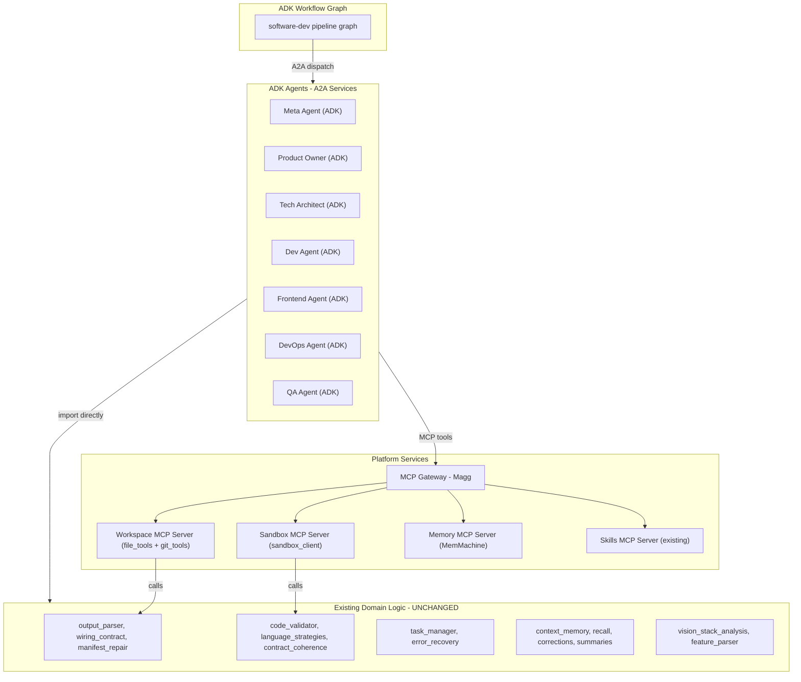

# Agent Swarm Platform — ADK + Wrap-Not-Rewrite

## Strategy

**Use Google ADK as the agent/workflow runtime. Keep all 33K+ lines of existing domain logic. Replace only the ~1,800 lines of LlamaIndex glue.**

## Tech Stack (final)

| Layer | Pick | Version | Risk | Fallback |
|---|---|---|---|---|
| **Agent framework** | Google ADK | v2.13.0 stable | Low | LiteLLM + raw function-calling (your code is 95% framework-free) |
| **Agent-to-agent** | A2A Protocol | v1.0 stable (LF) | Very low | Direct HTTP (A2A is just JSON-RPC over HTTP) |
| **Agent-to-tool** | MCP | 2026-07-28 stable | Low | Direct function calls (existing pattern) |
| **K8s sandbox** | K8s Agent Sandbox | v1.0.8 (v1beta1 API) | Low | Podman via existing podman-sandbox-api |
| **Local sandbox** | Podman + podman-sandbox-api | Stable | Very low | Already in production |
| **MCP gateway** | Magg or fastmcp proxy | Magg 1.x | Medium | Direct MCP connections (no aggregator) |
| **K8s agent lifecycle** | Standard K8s Deployments + A2A Agent Cards | Stable | Very low | N/A |
| **Memory plane** | MemMachine (existing) | 0.3.9+ | Low | Already in production, fail-open |
| **Observability** | OpenTelemetry | Stable | Very low | Already partially implemented |

## What stays, what changes

### Stays unchanged (33K+ lines)

```
utils/                          # 11,392 lines — ALL KEPT
├── wiring_contract.py          # 3,740L — file/manifest validation
├── output_parser.py            # 1,189L — LLM output → files
├── llm_config.py               # 1,337L — LLM provider abstraction (GenericLlamaLLM)
├── vision_stack_analysis.py    #   787L — stack inference
├── manifest_repair.py          #   402L — broken manifest recovery
├── contract_coherence.py       #   364L — inter-file consistency
├── prompt_budget.py            #   184L — token budget management
├── ... 20 more files

orchestrator/                   # 6,734 lines — ALL KEPT
├── task_manager.py             # 2,748L — per-file task tracking
├── code_validator.py           #   validated per language
├── error_recovery.py           #   retry strategies
├── state_machine.py            #   401L — state transitions
├── language_strategies.py      #   language-specific validation

memory/                         # 2,534 lines — ALL KEPT
├── context_memory.py           #   465L — MemMachine wrapper (fail-open)
├── postgres_context_store.py   #   563L — pgvector store
├── corrections.py              #   376L — reviewer correction tracking
├── summaries.py                #   353L — job outcome summaries
├── recall.py                   #   199L — solutioning recall
├── scope.py                    #   253L — org/project/domain scoping
├── artifact_seeder.py          #   220L — artifact seeding

tools/ (core logic)             # 4,344 lines — LOGIC KEPT, wrapper changes
├── file_tools.py               #   819L — safe file I/O (logic kept, FunctionTool → @mcp.tool)
├── test_tools.py               #   926L — test execution
├── tldr_tools.py               #   943L — code analysis
├── git_tools.py                #   434L — git operations
├── skill_tools.py              #   389L — skill search
├── sandbox_tools.py            #    65L — sandbox execution
├── mcp_bridge.py               #   318L — MCP client (kept for external MCP servers)

agents/ (prompts + phase logic) # 3,661 lines — LOGIC KEPT, base class changes
├── meta_agent.py               #   426L — vision analysis, backstories
├── tech_architect_agent.py     #   683L — stack design
├── refinement_agent.py         #   405L — brownfield refinement
├── designer_agent.py           #   290L — UX/UI design
├── product_owner_agent.py      #   215L — user stories, BDD
├── devops_agent.py             #   255L — Containerfile, CI/CD
├── dev_agent.py                #   174L — backend code gen
├── frontend_agent.py           #   152L — UI code gen
├── test_agent.py               #    97L — test writing

workflows/ (solutioning, epics) # 8,307 lines — LOGIC KEPT, dispatch changes
├── software_dev_workflow.py    # 6,944L — main pipeline (dispatch layer rebuilt in ADK graph)
├── solutioning_loop.py         #   569L — research/architect/critique
├── epic_story_loop.py          #   471L — epic decomposition
├── workflow_resolver.py        #   215L — pipeline resolution

crew_studio/                    # API + hooks — ALL KEPT
├── memory_hooks.py             #   738L — lifecycle write hooks
├── refinement_runner.py        #   job refinement
├── asgi_app.py                 #   FastAPI routes
```

### Changes (~1,800 lines replaced)

| File | Lines | Change |
|---|---|---|
| `base_agent.py` | 407 | Replace `BaseLlamaIndexAgent` → ADK `Agent` with `McpToolset` |
| `llm_config.py` | 1,337 | Replace `GenericLlamaLLM(FunctionCallingLLM)` → ADK `LiteLlm` model connector |
| `tool_loader.py` | 87 | Replace `FunctionTool` wrapping → MCP server registration |

### New code (~2,000 lines estimated)

| New module | Est. lines | Purpose |
|---|---|---|
| `adk_adapter.py` | ~200 | Thin adapter: existing agent class → ADK `Agent` with tools via `McpToolset` |
| `workspace_mcp_server.py` | ~150 | fastmcp server wrapping existing `file_tools` + `git_tools` functions |
| `sandbox_mcp_server.py` | ~80 | fastmcp server wrapping existing `sandbox_client` |
| `memory_mcp_server.py` | ~120 | fastmcp server exposing MemMachine recall/add/search |
| `adk_workflow_graph.py` | ~500 | ADK graph workflow replacing `phase_handlers` dispatch in `software_dev_workflow.py` |
| `a2a_agent_server.py` | ~100 | `adk api_server --a2a` config per agent |
| `token_pruner.py` | ~80 | Token-controlled session pruning (BeeAI idea, uses existing `prompt_budget.py`) |
| `step_validators.py` | ~150 | Pre/post-step validation callbacks (BeeAI RequirementAgent idea, uses existing validators) |
| K8s manifests | ~200 | Deployments + Services + optional Kagenti CRDs |
| `compose.yml` | ~150 | Platform services compose |

## Architecture



## How an agent wraps (example: Meta Agent)

```python
# Before: LlamaIndex
class MetaAgent(BaseLlamaIndexAgent):
    def __init__(self, ...):
        super().__init__(role="Meta Agent", tools=[FileWriterTool, ...], ...)
    def run(self, vision):
        return self.chat(prompt)  # ReAct/FunctionCalling loop

# After: ADK (same prompts, same logic, different shell)
from google.adk.agents import Agent
from google.adk.tools import McpToolset

meta_agent = Agent(
    name="meta-agent",
    model=LiteLlm(model="openai/qwen3-14b", api_base="..."),
    tools=[
        McpToolset(connection_params=SseServerParams(url="http://mcp-gateway:9090/mcp")),
    ],
    instruction="""You are a Meta Agent. <same prompt as before>""",
)
# Expose via A2A: adk api_server --a2a --agent meta_agent
```

The 426 lines of Meta Agent logic (vision analysis, backstory generation, delivery mode triage) stay exactly the same — they're prompt strings and dict manipulation, not framework code.

## How the workflow graph replaces phase_handlers

```python
# Before: hardcoded dict in software_dev_workflow.py line 6846
phase_handlers = {
    "meta": self.run_meta_phase,
    "stack_contract": self._run_stack_contract_phase,
    "product_owner": self.run_product_owner_phase,
    ...
}

# After: ADK graph workflow
from google.adk.workflows import Graph, Node, ParallelNode, ConditionalNode

software_dev = Graph(name="software-dev")

meta = Node("meta", agent=RemoteA2aAgent(url="http://meta-agent:9001"))
stack = ConditionalNode("stack_contract",
    branches={
        "fast": Node("fast_lock", agent=fast_stack_agent),
        "full": Node("solutioning", agent=solution_architect),
    },
    classifier=lambda ctx: ctx.state["capability_profile"],
)
plan = Node("product_owner", agent=RemoteA2aAgent(url="http://po-agent:9002"))
arch = Node("tech_architect", agent=RemoteA2aAgent(url="http://arch-agent:9003"),
    post_step=plan_review_gate,  # HITL — BeeAI RequirementAgent idea
)
build = ParallelNode("build", nodes=[
    Node("development", agent=RemoteA2aAgent(url="http://dev-agent:9004")),
    Node("frontend", agent=RemoteA2aAgent(url="http://frontend-agent:9005")),
    Node("devops", agent=RemoteA2aAgent(url="http://devops-agent:9006")),
])
qa = Node("qa", agent=RemoteA2aAgent(url="http://qa-agent:9007"),
    pre_step=validate_artifacts,  # BeeAI idea: pre-step validation
)

software_dev.add_edges(meta >> stack >> plan >> arch >> build >> qa)
```

## Stolen ideas from BeeAI (implemented in ADK)

### 1. Token-controlled memory (from BeeAI's memory strategies)

```python
# Uses existing prompt_budget.py logic
class TokenPrunedSessionService(InMemorySessionService):
    def __init__(self, max_tokens=8192):
        self.budget = PromptBudget(max_tokens)  # existing prompt_budget.py

    def get_session(self, session_id):
        session = super().get_session(session_id)
        session.events = self.budget.prune(session.events)  # trim oldest
        return session
```

### 2. Agent step constraints (from BeeAI's RequirementAgent)

```python
# Uses existing validators as pre/post-step callbacks
def post_step_validate(context, agent_output):
    """Runs after every agent step — catches stubs, hallucinated files."""
    from utils.output_parser import is_llm_stub_content, issues_indicate_unparsed_output
    if is_llm_stub_content(agent_output):
        raise RetryStep("Output contains stub/placeholder content")
    if issues_indicate_unparsed_output(agent_output):
        raise RetryStep("Output has unparsed format issues")

# Applied to workflow nodes
dev_node = Node("development", agent=dev_agent, post_step=post_step_validate)
```

## Spike scope (what we build first)

1. **Workspace MCP server** — wrap `file_tools.py` + `git_tools.py` as fastmcp
2. **ADK Meta Agent** — existing meta logic in an ADK Agent shell + A2A server
3. **ADK Dev Agent** — existing dev logic in an ADK Agent shell + A2A server
4. **ADK 2-node workflow** — meta → dev graph with A2A dispatch
5. **Compose stack** — MCP gateway + workspace + 2 agents + orchestrator
6. End-to-end test: submit a vision, get generated code

## Migration path (incremental)

Each agent migrates independently. The monolith and new platform coexist:

1. Wrap one agent (Meta) in ADK + A2A — test it works
2. Workflow graph calls Meta via A2A, everything else stays as direct method calls
3. Wrap next agent (Dev) — workflow graph calls both via A2A
4. Repeat for PO, Architect, Frontend, DevOps, QA
5. Once all agents are A2A services, retire `software_dev_workflow.py`
6. Deploy agents as K8s Deployments with A2A Agent Cards

## Eval System — Factory Quality Measurement

### Data already captured (no new instrumentation)

| Signal | Source | Table/Store |
|---|---|---|
| Validation checks (syntax, imports, deps, structure, entrypoint) | `code_validator.py` | `job_outcomes` (Postgres) |
| Check passed/failed + iterations to converge | `record_job(outcomes=[...])` | `job_outcomes.passed`, `.iterations`, `.converged` |
| Reviewer corrections | `memory_hooks.write_correction_memories()` | MemMachine + `memory_correction_keys` in job metadata |
| Refinement count | `write_job_outcome_memory()` | `refinement_count` in outcome signals |
| Token usage + cost per agent | `BudgetTracker` | Job DB |
| Job final status | `asgi_app` | Job DB (`completed`, `completed_with_errors`, `failed`, etc.) |
| Call graph edges | `record_job(call_graph_edges=[...])` | `call_graph_edges` (Postgres) |
| Prompts used | `record_job(prompts=[...])` | `prompts` (Postgres) |
| Artifacts produced | `record_job(json_artifacts={...})` | `artifacts` (Postgres JSONB) |
| Memory recalls used | `recall.py` | MemMachine search logs |
| Stub/placeholder detections | `output_parser.is_llm_stub_content()` | In-memory (needs persisting) |

### Layer 1: Per-job scorecard (automatic, every job)

Computed at job completion from existing data:

```python
@dataclass
class JobScorecard:
    job_id: str
    framework: str
    domain: str
    
    # Quality
    validation_pass_rate: float      # checks_passed / checks_total
    first_pass_rate: float           # passed_without_retry / checks_total
    avg_iterations_to_fix: float     # mean(iterations) for initially-failed checks
    stub_rate: float                 # stub_files / total_files
    corrections_count: int           # reviewer + auto-fix corrections
    refinement_rounds: int           # user-requested refinements
    
    # Efficiency
    total_cost: float                # USD
    total_tokens: int
    cost_per_file: float             # cost / files_generated
    wall_time_seconds: int
    files_generated: int
    
    # Memory utilization
    recalls_used: int                # past knowledge applied
    recall_candidates: int           # matches found (some may be filtered)
    corrections_written: int         # new corrections stored for future jobs
    
    # Final status
    status: str                      # completed, completed_with_errors, failed
    
    # Computed grade (weighted composite)
    grade: float                     # 0-100, weighted across dimensions
```

Grade formula (configurable weights):

```python
grade = (
    validation_pass_rate * 30 +      # 30% weight — does the code work?
    first_pass_rate * 20 +           # 20% weight — got it right first try?
    (1 - stub_rate) * 15 +           # 15% weight — no placeholder code
    (1 - min(corrections/10, 1)) * 15 +  # 15% weight — fewer corrections = better
    (1 - min(cost/budget, 1)) * 10 + # 10% weight — cost efficiency
    recall_hit_rate * 10             # 10% weight — using past knowledge
)
```

### Layer 2: Trend analysis (cross-job, scoped)

Time-series aggregation of scorecards:

```sql
-- Example: weekly trend for Frappe projects
SELECT 
    date_trunc('week', created_at) AS week,
    AVG(validation_pass_rate) AS avg_pass_rate,
    AVG(first_pass_rate) AS avg_first_pass,
    AVG(corrections_count) AS avg_corrections,
    AVG(cost_per_file) AS avg_cost_per_file,
    AVG(grade) AS avg_grade,
    COUNT(*) AS job_count
FROM job_scorecards
WHERE framework = 'frappe' 
  AND created_at > NOW() - INTERVAL '90 days'
GROUP BY week
ORDER BY week;
```

Trend analysis answers: "Is the factory improving for Frappe projects?" "Did the new skill we added last week actually help?"

### Layer 3: Benchmark suite (controlled, periodic)

Fixed visions run periodically to measure improvement under controlled conditions:

```yaml
# eval/benchmarks/frappe-crm.yaml
name: "Frappe CRM"
vision: "Build a Frappe CRM application with contacts, deals, pipeline stages, and activity logging"
framework: frappe
domain: crm
expected:
  min_files: 8
  required_files:
    - "*/doctype/contact/contact.py"
    - "*/doctype/deal/deal.py"
    - "*/doctype/pipeline_stage/pipeline_stage.json"
  checks:
    syntax: pass
    imports: pass
    entrypoint: pass
    package_structure: pass
  max_cost: 1.00
  max_corrections: 2
  min_grade: 70
baselines:
  - date: "2026-11-01"
    grade: 62
    pass_rate: 0.75
    cost: 0.89
```

Benchmark runner:
1. Submits the vision via `POST /api/jobs`
2. Polls until completion
3. Fetches scorecard via `GET /api/jobs/{id}/scorecard`
4. Compares against baselines and expected thresholds
5. Writes results to `eval_benchmark_runs` table
6. Alerts if grade regresses below baseline

### Eval API endpoints

```
GET  /api/jobs/{id}/scorecard          → JobScorecard
GET  /api/eval/trends                  → TrendData[]
     ?framework=frappe
     &domain=crm
     &window=90d
     &granularity=week
GET  /api/eval/benchmarks              → BenchmarkDefinition[]
GET  /api/eval/benchmarks/{name}/runs  → BenchmarkRun[]
POST /api/eval/benchmarks/run          → trigger benchmark suite
     ?names=frappe-crm,fastapi-todo    (or all if omitted)
```

### New tables (Postgres context plane)

```sql
CREATE TABLE job_scorecards (
    job_id       TEXT PRIMARY KEY REFERENCES jobs(job_id),
    framework    TEXT,
    domain       TEXT,
    validation_pass_rate  REAL,
    first_pass_rate       REAL,
    avg_iterations        REAL,
    stub_rate             REAL,
    corrections_count     INTEGER,
    refinement_rounds     INTEGER,
    total_cost            REAL,
    total_tokens          BIGINT,
    cost_per_file         REAL,
    wall_time_seconds     INTEGER,
    files_generated       INTEGER,
    recalls_used          INTEGER,
    corrections_written   INTEGER,
    grade                 REAL,
    status                TEXT,
    created_at            TIMESTAMPTZ DEFAULT NOW()
);

CREATE TABLE eval_benchmark_runs (
    id           SERIAL PRIMARY KEY,
    benchmark    TEXT NOT NULL,
    job_id       TEXT REFERENCES jobs(job_id),
    grade        REAL,
    pass_rate    REAL,
    cost         REAL,
    met_expected BOOLEAN,
    delta_vs_baseline REAL,  -- grade improvement vs first baseline
    created_at   TIMESTAMPTZ DEFAULT NOW()
);
```
