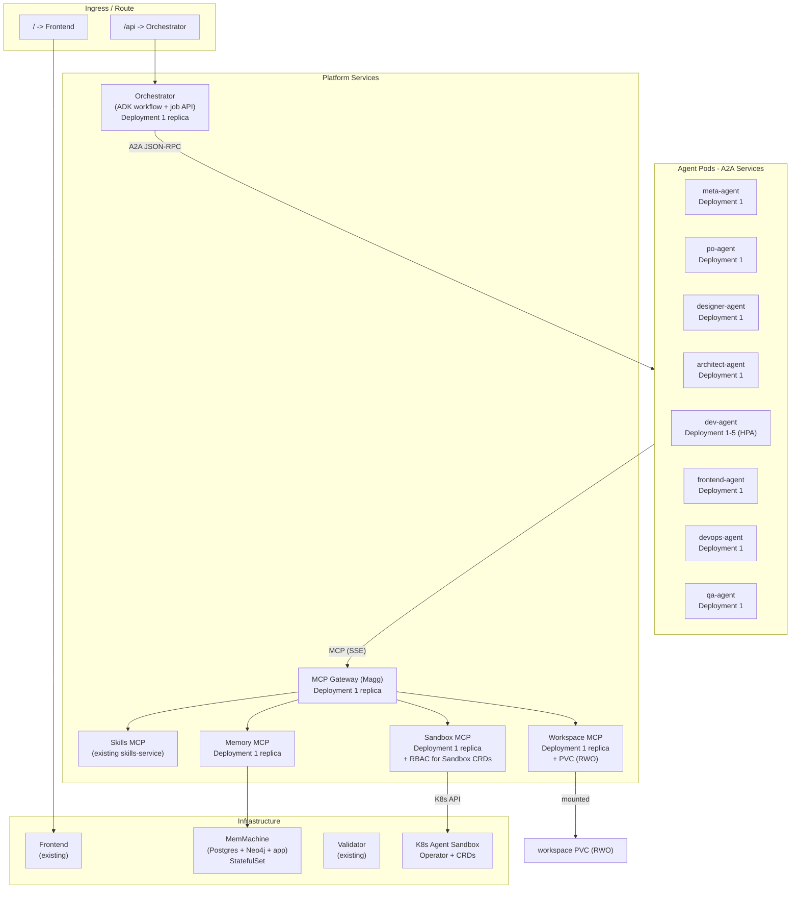

# K8s Agent Swarm Deployment Architecture

## Current state

The existing Helm umbrella chart (`helm/opl-crew/`) deploys a **monolith backend pod** that runs all agents in-process. The new architecture splits this into ~15 independent pods:

- 8 agent pods (one per role, each an A2A service)
- 4 MCP tool server pods (workspace, sandbox, memory, skills)
- 1 MCP gateway pod (aggregator)
- 1 orchestrator pod (ADK workflow graph + job API)
- 1 frontend pod (existing, unchanged)

## Architecture overview



## Key design decisions

### 1. Workspace sharing via MCP, not PVC mounts

Agents do **not** mount the workspace PVC directly. Only the Workspace MCP Server pod mounts it (RWO). Agents read/write files via MCP tool calls (`workspace://write_file`, `workspace://read_file`, `workspace://git_commit`).

Why:
- No need for ReadWriteMany storage class (RWX) -- RWO works everywhere
- Single writer avoids file locking / corruption from concurrent writes
- Workspace MCP Server enforces validation (uses existing `output_parser.py`, `wiring_contract.py`) before writing
- Works identically on any K8s flavor (no NFS/CephFS dependency)

### 2. One agent per pod with A2A discovery

Each agent is a separate Deployment + ClusterIP Service, running `adk api_server --a2a` on a standard port (9000). Agent Cards served at `/.well-known/agent.json`.

Discovery: The Orchestrator resolves agents via K8s Service DNS:
- `http://meta-agent.crew.svc.cluster.local:9000`
- `http://dev-agent.crew.svc.cluster.local:9000`

No service mesh required. A2A is JSON-RPC over HTTP -- plain ClusterIP Services handle it.

### 3. K8s Agent Sandbox integration

The Sandbox MCP Server pod has a ServiceAccount with RBAC to create/delete Sandbox CRDs:

```yaml
rules:
  - apiGroups: ["sandbox.k8s.io"]
    resources: ["sandboxes", "sandboxtemplates"]
    verbs: ["get", "list", "create", "delete", "watch"]
```

Pre-defined SandboxTemplates for common stacks:

```yaml
apiVersion: sandbox.k8s.io/v1beta1
kind: SandboxTemplate
metadata:
  name: python-runner
spec:
  runtimeClassName: gvisor  # or kata
  containers:
    - name: runner
      image: registry.access.redhat.com/ubi9/python-311:latest
      resources:
        limits: { cpu: "2", memory: "2Gi" }
  timeout: 300s
---
apiVersion: sandbox.k8s.io/v1beta1
kind: SandboxWarmPool
metadata:
  name: python-pool
spec:
  templateRef: python-runner
  minReady: 2    # keep 2 warm sandboxes ready
  maxSize: 10
```

### 4. Scaling strategy

| Pod | Default replicas | HPA | Scale trigger |
|---|---|---|---|
| Orchestrator | 1 | No (stateful -- job DB) | Manual |
| MCP Gateway | 1 | Yes (2-3) | CPU 70% |
| Workspace MCP | 1 | No (single writer, mounted PVC) | Manual |
| Sandbox MCP | 1 | Yes (1-3) | CPU 70% |
| Memory MCP | 1 | No | Manual |
| Meta Agent | 1 | No (runs once per job) | Manual |
| PO Agent | 1 | No | Manual |
| Designer Agent | 1 | No | Manual |
| Architect Agent | 1 | No | Manual |
| **Dev Agent** | **1-5** | **Yes** | **CPU 60% or queue depth** |
| Frontend Agent | 1-3 | Yes | CPU 70% |
| DevOps Agent | 1 | No | Manual |
| QA Agent | 1-2 | Yes | CPU 70% |

Dev Agent is the primary scale target -- it does the most work and benefits from parallelism (multiple files generated concurrently).

### 5. Resource budgets

| Pod category | CPU request | CPU limit | Memory request | Memory limit |
|---|---|---|---|---|
| Agent (light: PO, Designer) | 100m | 500m | 256Mi | 512Mi |
| Agent (heavy: Dev, Architect) | 250m | 1 | 512Mi | 1Gi |
| MCP Server | 100m | 500m | 256Mi | 512Mi |
| MCP Gateway | 100m | 500m | 256Mi | 512Mi |
| Orchestrator | 250m | 1 | 512Mi | 2Gi |
| Sandbox MCP | 100m | 500m | 256Mi | 512Mi |

Agents are **I/O-bound** (waiting for LLM API responses), not CPU-bound. Low CPU requests are appropriate. The actual compute happens in LLM API servers and K8s Sandboxes.

## Helm chart structure

Extend the existing umbrella chart pattern:

```
helm/
  opl-crew/                          # existing umbrella
    Chart.yaml                       # add new dependencies
    values.yaml                      # add new service configs
    charts/
      # ── Existing (kept) ──
      frontend/                      # unchanged
      validator/                     # unchanged
      skills-service/                # unchanged
      jira/                          # unchanged
      connector/                     # unchanged
      
      # ── Replaced ──
      backend/                       # RETIRED -- replaced by orchestrator + agents
      
      # ── New: Platform ──
      orchestrator/                  # ADK workflow graph + job API
        templates/
          deployment.yaml
          service.yaml
          pvc.yaml                   # job DB
          secret.yaml                # LLM config
          serviceaccount.yaml
          ingress.yaml
        values.yaml
      mcp-gateway/                   # Magg aggregator
        templates/
          deployment.yaml
          service.yaml
          configmap.yaml             # upstream MCP server URLs
        values.yaml
      workspace-mcp/                 # file I/O MCP server
        templates/
          deployment.yaml
          service.yaml
          pvc.yaml                   # workspace storage (RWO)
        values.yaml
      sandbox-mcp/                   # K8s Agent Sandbox MCP server
        templates/
          deployment.yaml
          service.yaml
          serviceaccount.yaml        # RBAC for Sandbox CRDs
          clusterrole.yaml
          clusterrolebinding.yaml
          sandbox-templates.yaml     # SandboxTemplate + WarmPool CRDs
        values.yaml
      memory-mcp/                    # MemMachine MCP server
        templates/
          deployment.yaml
          service.yaml
        values.yaml
      
      # ── New: Agents (one subchart, parameterized) ──
      agent/                         # generic agent subchart (reused per role)
        templates/
          deployment.yaml            # ADK agent + A2A server
          service.yaml               # ClusterIP on port 9000
          hpa.yaml                   # optional, gated on autoscaling.enabled
          serviceaccount.yaml
        values.yaml
```

The `agent/` subchart is a **generic template** instantiated per role via aliases in `Chart.yaml`:

```yaml
# Chart.yaml
dependencies:
  # ... existing ...
  
  - name: agent
    version: 0.1.0
    repository: file://charts/agent
    alias: meta-agent
    condition: agents.meta.enabled
  
  - name: agent
    version: 0.1.0
    repository: file://charts/agent
    alias: po-agent
    condition: agents.po.enabled
  
  - name: agent
    version: 0.1.0
    repository: file://charts/agent
    alias: dev-agent
    condition: agents.dev.enabled
  
  # ... repeat for each agent role ...
```

Per-role config in `values.yaml`:

```yaml
agents:
  meta:
    enabled: true
    image:
      repository: quay.io/varkrish/crew-agent
      tag: latest
    env:
      AGENT_ROLE: meta
      AGENT_NAME: "Meta Agent"
      ADK_MODEL: "openai/qwen3-14b"
      MCP_GATEWAY_URL: "http://opl-crew-mcp-gateway:9090/mcp"
    resources:
      requests: { cpu: 100m, memory: 256Mi }
      limits: { cpu: 500m, memory: 512Mi }
    autoscaling:
      enabled: false

  dev:
    enabled: true
    image:
      repository: quay.io/varkrish/crew-agent
      tag: latest
    env:
      AGENT_ROLE: dev
      AGENT_NAME: "Dev Agent"
      ADK_MODEL: "openai/qwen3-14b"
      MCP_GATEWAY_URL: "http://opl-crew-mcp-gateway:9090/mcp"
    resources:
      requests: { cpu: 250m, memory: 512Mi }
      limits: { cpu: "1", memory: 1Gi }
    autoscaling:
      enabled: true
      minReplicas: 1
      maxReplicas: 5
      targetCPUUtilizationPercentage: 60
```

## Single agent container image

All agents share **one container image** (`crew-agent`). The `AGENT_ROLE` env var selects which agent logic to load at startup:

```
Containerfile.agent
├── Base: registry.access.redhat.com/ubi9/python-311
├── Install: google-adk, a2a-sdk, fastmcp, litellm
├── Copy: agent/src/ (all agent logic -- prompts, parsers, validators, tools)
├── Copy: crew_studio/ (memory hooks, config)
├── Entrypoint: python -m crew_agent.main
│   └── reads AGENT_ROLE env → loads corresponding agent module
│   └── starts `adk api_server --a2a` on port 9000
```

One image, many deployments. Build once, deploy as meta-agent, dev-agent, qa-agent, etc.

## Network policies

```yaml
apiVersion: networking.k8s.io/v1
kind: NetworkPolicy
metadata:
  name: agent-network-policy
spec:
  podSelector:
    matchLabels:
      app.kubernetes.io/component: agent
  policyTypes: [Ingress, Egress]
  ingress:
    - from:
        - podSelector:
            matchLabels:
              app.kubernetes.io/component: orchestrator
      ports:
        - port: 9000   # A2A
  egress:
    - to:
        - podSelector:
            matchLabels:
              app.kubernetes.io/component: mcp-gateway
      ports:
        - port: 9090   # MCP
    - to:                # LLM API (external)
        - ipBlock:
            cidr: 0.0.0.0/0
      ports:
        - port: 443
```

Agents can only:
- Receive A2A calls from the Orchestrator
- Make MCP calls to the Gateway
- Call external LLM APIs (HTTPS)
- Nothing else. No K8s API, no direct filesystem, no cross-agent chatter.

## Secrets management

```yaml
# LLM config (shared across agents via env)
apiVersion: v1
kind: Secret
metadata:
  name: opl-crew-llm-config
type: Opaque
stringData:
  LLM_API_KEY: "..."
  LLM_API_BASE_URL: "https://litellm-prod.apps.maas.redhatworkshops.io"
  LLM_MODEL_MANAGER: "qwen3-14b"
  LLM_MODEL_WORKER: "deepseek-r1-distill-qwen-14b"
```

All agent pods reference the same Secret via `envFrom`. The Orchestrator also uses it. Existing `secure_config.py` handles the env var resolution -- zero code changes.

## Migration path from monolith

```
Phase 1: Deploy platform services alongside monolith
  - MCP Gateway, Workspace MCP, Sandbox MCP, Memory MCP
  - Monolith backend still handles all jobs
  - Validate MCP servers work independently

Phase 2: Deploy first agent pods
  - Meta Agent + Dev Agent as A2A services
  - Orchestrator with 2-node workflow (meta -> dev)
  - Run test jobs through new path
  - Monolith still serves production jobs

Phase 3: Migrate remaining agents
  - PO, Architect, Designer, Frontend, DevOps, QA
  - Full ADK workflow graph
  - Feature flag: new jobs go to new path, existing jobs stay on monolith

Phase 4: Retire monolith
  - Remove backend subchart from umbrella
  - All jobs through ADK orchestrator + A2A agents
```

## What is NOT in scope

- Service mesh (Istio/Linkerd) -- unnecessary, A2A is plain HTTP
- Custom operator for agent lifecycle -- standard Deployments + HPA suffice
- Kagenti CRDs -- deferred until Kagenti reaches beta; standard K8s resources are sufficient and more portable
- GPU scheduling -- agents are I/O bound (LLM API calls), not compute bound
- Multi-cluster -- single cluster deployment
